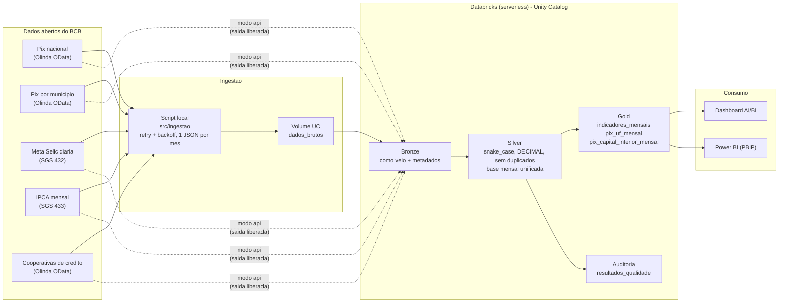

# pix-macro-lakehouse

Pipeline de dados em arquitetura medalhao no Databricks, construido sobre dados abertos do
Banco Central do Brasil, para responder a uma pergunta de negocio:

> **Como o Pix cresceu no Brasil e como isso se relaciona com juros (Selic) e inflacao (IPCA)?**
> E, por dentro do pais: onde o uso do Pix e mais intenso e quanto vem do interior, nao da capital?

O projeto foi desenhado como um portfolio de engenharia de dados para o setor financeiro, onde
**dado confiavel e auditavel** vale mais do que grafico bonito. Por isso qualidade de dados,
governanca no Unity Catalog e reprodutibilidade aparecem em primeiro plano.

> Versao em ingles: no backlog. Toda a documentacao esta em portugues por enquanto.

## Principais resultados (dados ate outubro de 2026)

O Pix foi aberto ao publico em 16/11/2020, entao novembro de 2020 e um mes parcial. A
comparacao parte de dezembro de 2020, o primeiro mes completo. Valores em reais correntes,
sem correcao pela inflacao.

> **Cobertura do dado do Pix: o que esta serie mede.** As series abertas usadas aqui contam o
> Pix **liquidado no SPI**, o sistema de liquidacao do BCB. A documentacao do
> [conjunto de dados](https://dadosabertos.bcb.gov.br/dataset/pix/resource/d5430811-0ef7-4404-bc87-d76aa5cfebcd)
> avisa que ele "nao inclui Pix liquidados nos livros do participante, isto e, transacoes nao
> enviadas para liquidacao no SPI". Comparando com os totais anuais divulgados pelo BC (2024:
> 63,5 bilhoes de transacoes e R$ 26,5 trilhoes; 2025: 79,8 bilhoes e R$ 35,4 trilhoes), a
> serie cobre cerca de 89% das transacoes e 84% do valor. Ela serve para tendencia e recorte
> regional; nao e o total do Pix. A serie por municipio soma o mesmo que a nacional (regra de
> reconciliacao), entao tem a mesma cobertura.

| Indicador (Pix liquidado no SPI) | Dez/2020 | Out/2026 |
|---|---|---|
| Transacoes no mes | 124,9 milhoes | 7,37 bilhoes |
| Valor no mes | R$ 107,2 bilhoes | R$ 3,28 trilhoes |
| Ticket medio | R$ 858 | R$ 445 |
| Meta Selic (media do mes) | 2,00% a.a. | 13,75% a.a. |
| IPCA acumulado 12 meses | 4,52% | 4,63% |

- **Crescimento.** No Pix liquidado no SPI, a quantidade mensal de transacoes multiplicou por
  59 e o valor por 31.
  A quantidade caiu em relacao ao mes anterior em 16 dos 71 meses, 9 deles em janeiro ou
  fevereiro, mas ficou acima do mesmo mes do ano anterior em todos. Em out/2026 a alta em 12
  meses foi de 14,2%, a menor da serie.
- **Juros e inflacao no mesmo periodo.** A meta Selic foi de 2% a 15% ao ano e estava em
  13,75% em out/2026; o IPCA em 12 meses chegou a 12,1%. O Pix cresceu tanto com juros baixos
  quanto altos. O projeto mostra as series lado a lado e nao estima efeito causal.
- **Ticket medio.** Caiu de R$ 858 (dez/2020) para R$ 368 (mar/2024) e subiu para R$ 445
  (out/2026).
- **Uso por pessoa fisica.** Em out/2026 o Amazonas teve a maior media de transacoes por
  pessoa fisica pagadora (62,7), seguido de Amapa (60,2) e Para (54,6). Os tres estados do Sul
  ficaram nas ultimas posicoes: Rio Grande do Sul em 25o (36,2), Parana em 26o (35,9) e Santa
  Catarina em 27o (32,1).
- **Capital x interior no RS.** Em out/2026 o interior respondeu por 73,6% do valor pago via
  Pix por residentes do estado e reunia 85,3% das pessoas fisicas pagadoras. Desde dez/2020
  a participacao do interior no valor variou entre 72,8% e 79,2%.
- **Concentracao.** Sao Paulo respondeu por 37,8% do valor pago no pais em out/2026.
- **Cooperativas de credito (fase 1.5).** O cadastro do BCB consultado em nov/2026 lista 736
  cooperativas em funcionamento, 702 delas singulares. Minas Gerais (156) e Sao Paulo (150) tem
  mais sedes; o Rio Grande do Sul tem 81 (11% do pais), 44 de livre admissao. Os tres estados
  do Sul somam 238 sedes, 32% do total. A contagem absoluta muda conforme a publicacao: o
  [Panorama do SNCC](https://www.bcb.gov.br/content/estabilidadefinanceira/coopcredpanorama/panorama_cooperativas_sncc_anobase_dez_2025_FINAL_comnota.pdf)
  do BCB registra 742 singulares em dez/2025. A diferenca ainda nao foi conciliada (backlog);
  por isso o projeto destaca a distribuicao por UF, nao o total.
- **Qualidade verificada entre fontes.** As duas fontes do Pix do BCB (nacional e por municipio)
  batem dentro de 0,1% em 68 dos 72 meses. Em 4 meses (nov/2020, set/2023, out/2025 e
  fev/2026) a soma por municipio fica 3% a 6,5% abaixo da nacional. Os arquivos desses meses
  vieram completos, com todos os municipios e sem nulos; a causa ainda nao foi identificada.
  A divergencia fica registrada na tabela de auditoria como aviso.

<!-- Prints do dashboard: pendentes de nova captura. -->

## Arquitetura



**Job serverless** (Declarative Automation Bundle): `preparar_ambiente -> bronze -> silver -> gold`.
Se uma regra de qualidade de severidade `erro` falhar na silver, o job para e a gold nao e
reconstruida: dado duvidoso nao chega ao dashboard.

| Camada | O que tem | Idempotencia |
|---|---|---|
| Bronze | Colunas com os nomes originais da API + `fonte`, `url_origem`, `parametros_requisicao`, `baixado_em`, `arquivo_origem`, `carregado_em` | Pix: `replaceWhere` por mes; SGS: sobrescrita (pequeno) |
| Silver | Tipos de negocio, `row_number` para deduplicar, mes corrente excluido, `base_mensal` (Pix + Selic + IPCA) | Reconstruida inteira |
| Gold | Crescimento mensal e 12m, IPCA 12m por produto `(prod(1+t/100)-1)`, Selic media, recorte UF e capital x interior com `lag` e `sum over` | Reconstruida inteira |
| Auditoria | Uma linha por regra por execucao: nulos, faixa, unicidade, continuidade de meses, reconciliacao entre fontes | Historico, nunca sobrescrito |

## Governanca e qualidade como diferencial

- **Especificacao unica de tabelas** (`src/catalogo/tabelas.py`): colunas, tipos e comentarios de
  todas as camadas em um lugar. Dela saem o DDL (`sql/ddl/`), os comentarios reaplicados no
  Unity Catalog a cada execucao, a evolucao de esquema (`ALTER TABLE ADD COLUMNS`) e o esquema
  usado pelo Spark. Um teste garante que nenhuma coluna fica sem comentario.
- **Regras de qualidade versionadas com o codigo** e testadas sem Spark. Resultado gravado em
  tabela com severidade (`erro` bloqueia, `aviso` registra) e detalhe legivel.
- **Reconciliacao entre fontes independentes**: a soma nacional do Pix contra a soma por
  municipio, mes a mes.
- **Rastreabilidade**: toda linha do bronze sabe de qual URL, com quais parametros e quando veio.

## Como rodar

Pre-requisitos: Python 3.11+, Git, CLI do Databricks (`winget install Databricks.DatabricksCLI`),
um workspace Databricks (o Free Edition basta).

```bash
pip install -r requirements.txt
python -m pytest                                      # 34 testes, < 1 s, sem Spark

# 1) baixar os dados brutos (Pix e lento: ~15 min na primeira vez)
python -m src.ingestao.baixar_dados_brutos
python -m src.ingestao.baixar_dados_brutos --somente-faltantes   # execucoes seguintes

# 2) autenticar e subir os JSONs para o Volume do Unity Catalog
databricks auth login --host https://SEU-WORKSPACE.cloud.databricks.com --profile pix-macro
databricks schemas create pix_macro_bronze workspace --profile pix-macro
databricks volumes create workspace pix_macro_bronze dados_brutos MANAGED --profile pix-macro
python -m src.ingestao.subir_volume --perfil pix-macro

# 3) publicar e rodar o pipeline (job serverless + dashboard)
databricks bundle validate -t dev
databricks bundle deploy -t dev
databricks bundle run -t dev pipeline_pix_macro
```

Parametros do job: `modo_origem` (`volume`, padrao, ou `api` quando o workspace tem saida para
a internet), `fontes` (lista separada por virgula; vazio = todas) e `mes_fim` (AAAAMM).

## Estrutura do repositorio

```
config/configuracoes.py      catalogo, schemas, tabelas, fontes e datas: um unico lugar
src/ingestao/                clientes HTTP das APIs do BCB, download local, upload ao Volume
src/transformacoes/          regras de negocio em Python puro (testadas com pytest)
src/catalogo/                especificacao das tabelas e gerador de DDL
src/spark/                   utilitarios PySpark (unico modulo que importa pyspark)
notebooks/00..03_*.py        notebooks no formato fonte do Databricks
sql/ddl/                     CREATE TABLE com COMMENT, gerado da especificacao
tests/                       pytest
resources/, databricks.yml   bundle: job serverless e dashboard AI/BI
dashboards/                  definicao do dashboard AI/BI (JSON)
powerbi/                     projeto Power BI (PBIP com modelo TMDL e medidas DAX)
docs/                        aprendizado.md (conceitos, perguntas de entrevista, exercicios)
```

## Fontes

- [Estatisticas do Pix (API Olinda)](https://dadosabertos.bcb.gov.br/dataset/pix) e a
  [descricao do recurso](https://dadosabertos.bcb.gov.br/dataset/pix/resource/d5430811-0ef7-4404-bc87-d76aa5cfebcd)
  (cobertura: Pix liquidado no SPI)
- [SGS, serie 432 (meta Selic) e serie 433 (IPCA)](https://dadosabertos.bcb.gov.br/dataset/432-taxa-de-juros---selic)
- [Relacao de instituicoes em funcionamento (cooperativas)](https://dadosabertos.bcb.gov.br/dataset/relacao-de-instituicoes-em-funcionamento-no-pais)

Licenca dos dados: Open Data Commons Open Database License (ODbL), conforme o portal de dados
abertos do BCB.
