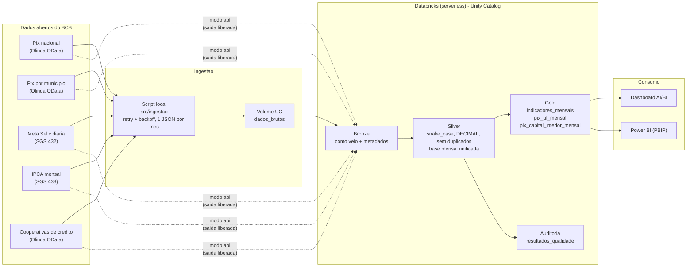

# pix-macro-lakehouse

Pipeline de dados em arquitetura medalhao no Databricks, construido sobre dados abertos do
Banco Central do Brasil, para responder a uma pergunta de negocio:

> **Como o Pix cresceu no Brasil e como isso se relaciona com juros (Selic) e inflacao (IPCA)?**
> E, por dentro do pais: onde o uso do Pix e mais intenso e quanto vem do interior, nao da capital?

O projeto foi desenhado como um portfolio de engenharia de dados para o setor financeiro, onde
**dado confiavel e auditavel** vale mais do que grafico bonito. Por isso qualidade de dados,
governanca no Unity Catalog e reprodutibilidade aparecem em primeiro plano.

> Versao em ingles: no backlog. Toda a documentacao esta em portugues por enquanto.

## Principais resultados (dados ate outubro de 2026)

| Indicador | Nov/2020 (lancamento) | Out/2026 |
|---|---|---|
| Transacoes Pix no mes | 29,5 milhoes | 7,37 bilhoes |
| Valor liquidado no mes | R$ 25,9 bilhoes | R$ 3,28 trilhoes |
| Ticket medio | R$ 876 | R$ 445 |
| Meta Selic (media do mes) | 2,00% a.a. | 13,75% a.a. |
| IPCA acumulado 12 meses | 4,31% | 4,63% |

- **O Pix cresceu nos dois ciclos de juros.** A Selic foi de 2% para 15% ao ano e voltou a cair;
  o volume do Pix subiu continuamente nos dois cenarios. Em 12 meses ate out/2026 a quantidade de
  transacoes ainda cresceu 14%.
- **O ticket medio caiu pela metade.** O Pix deixou de ser transferencia ocasional de valor alto
  e virou o pagamento do dia a dia: sinal de inclusao financeira e de uso cotidiano.
- **Interiorizacao.** No Rio Grande do Sul, 73,6% do valor pago via Pix em out/2026 saiu do
  interior (496 municipios) e 26,4% da capital. O dashboard permite comparar qualquer UF.
- **Concentracao de valor, uso cotidiano no Norte.** Sao Paulo responde por 37,8% do valor
  pago no pais, mas o uso mais intenso por pessoa fisica esta no Norte: no Amazonas cada
  pessoa que pagou via Pix fez em media 63 transacoes em out/2026 (Amapa 60, Para 55),
  sinal de que o Pix substitui dinheiro e agencia onde o atendimento bancario e mais escasso.
- **Qualidade verificada entre fontes.** As duas fontes do Pix do BCB (nacional e por municipio)
  batem dentro de 0,1% em 68 dos 72 meses; os 4 meses divergentes (3% a 6,5%) estao registrados
  na tabela de auditoria e sinalizados como aviso.

<!-- PRINT: docs/img/dashboard_visao_geral.png -->
*(espaco reservado para o print do dashboard AI/BI)*

## Arquitetura



**Job serverless** (Declarative Automation Bundle): `preparar_ambiente -> bronze -> silver -> gold`.
Se uma regra de qualidade de severidade `erro` falhar na silver, o job para e a gold nao e
reconstruida: dado duvidoso nao chega ao dashboard.

| Camada | O que tem | Idempotencia |
|---|---|---|
| Bronze | Colunas com os nomes originais da API + `fonte`, `url_origem`, `parametros_requisicao`, `baixado_em`, `arquivo_origem`, `carregado_em` | Pix: `replaceWhere` por mes; SGS: sobrescrita (pequeno) |
| Silver | Tipos de negocio, `row_number` para deduplicar, mes corrente excluido, `base_mensal` (Pix + Selic + IPCA) | Reconstruida inteira |
| Gold | Crescimento mensal e 12m, IPCA 12m por produto `(prod(1+t/100)-1)`, Selic media, recorte UF e capital x interior com `lag` e `sum over` | Reconstruida inteira |
| Auditoria | Uma linha por regra por execucao: nulos, faixa, unicidade, continuidade de meses, reconciliacao entre fontes | Historico, nunca sobrescrito |

## Governanca e qualidade como diferencial

- **Especificacao unica de tabelas** (`src/catalogo/tabelas.py`): colunas, tipos e comentarios de
  todas as camadas em um lugar. Dela saem o DDL (`sql/ddl/`), os comentarios reaplicados no
  Unity Catalog a cada execucao, a evolucao de esquema (`ALTER TABLE ADD COLUMNS`) e o esquema
  usado pelo Spark. Um teste garante que nenhuma coluna fica sem comentario.
- **Regras de qualidade versionadas com o codigo** e testadas sem Spark. Resultado gravado em
  tabela com severidade (`erro` bloqueia, `aviso` registra) e detalhe legivel.
- **Reconciliacao entre fontes independentes**: a soma nacional do Pix contra a soma por
  municipio, mes a mes.
- **Rastreabilidade**: toda linha do bronze sabe de qual URL, com quais parametros e quando veio.

## Como rodar

Pre-requisitos: Python 3.11+, Git, CLI do Databricks (`winget install Databricks.DatabricksCLI`),
um workspace Databricks (o Free Edition basta).

```bash
pip install -r requirements.txt
python -m pytest                                      # 34 testes, < 1 s, sem Spark

# 1) baixar os dados brutos (Pix e lento: ~15 min na primeira vez)
python -m src.ingestao.baixar_dados_brutos
python -m src.ingestao.baixar_dados_brutos --somente-faltantes   # execucoes seguintes

# 2) autenticar e subir os JSONs para o Volume do Unity Catalog
databricks auth login --host https://SEU-WORKSPACE.cloud.databricks.com --profile pix-macro
databricks schemas create pix_macro_bronze workspace --profile pix-macro
databricks volumes create workspace pix_macro_bronze dados_brutos MANAGED --profile pix-macro
python -m src.ingestao.subir_volume --perfil pix-macro

# 3) publicar e rodar o pipeline (job serverless + dashboard)
databricks bundle validate -t dev
databricks bundle deploy -t dev
databricks bundle run -t dev pipeline_pix_macro
```

Parametros do job: `modo_origem` (`volume`, padrao, ou `api` quando o workspace tem saida para
a internet), `fontes` (lista separada por virgula; vazio = todas) e `mes_fim` (AAAAMM).

## Estrutura do repositorio

```
config/configuracoes.py      catalogo, schemas, tabelas, fontes e datas: um unico lugar
src/ingestao/                clientes HTTP das APIs do BCB, download local, upload ao Volume
src/transformacoes/          regras de negocio em Python puro (testadas com pytest)
src/catalogo/                especificacao das tabelas e gerador de DDL
src/spark/                   utilitarios PySpark (unico modulo que importa pyspark)
notebooks/00..03_*.py        notebooks no formato fonte do Databricks
sql/ddl/                     CREATE TABLE com COMMENT, gerado da especificacao
tests/                       pytest
resources/, databricks.yml   bundle: job serverless e dashboard AI/BI
dashboards/                  definicao do dashboard AI/BI (JSON)
powerbi/                     projeto Power BI (PBIP com modelo TMDL e medidas DAX)
docs/                        aprendizado.md (conceitos, perguntas de entrevista, exercicios)
```

## Fontes

- [Estatisticas do Pix (API Olinda)](https://dadosabertos.bcb.gov.br/dataset/pix)
- [SGS, serie 432 (meta Selic) e serie 433 (IPCA)](https://dadosabertos.bcb.gov.br/dataset/432-taxa-de-juros---selic)
- [Relacao de instituicoes em funcionamento (cooperativas)](https://dadosabertos.bcb.gov.br/dataset/relacao-de-instituicoes-em-funcionamento-no-pais)

Licenca dos dados: Open Data Commons Open Database License (ODbL), conforme o portal de dados
abertos do BCB.
